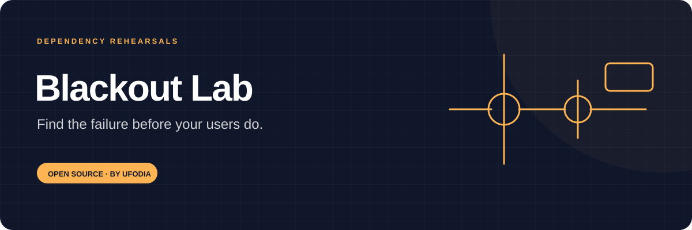
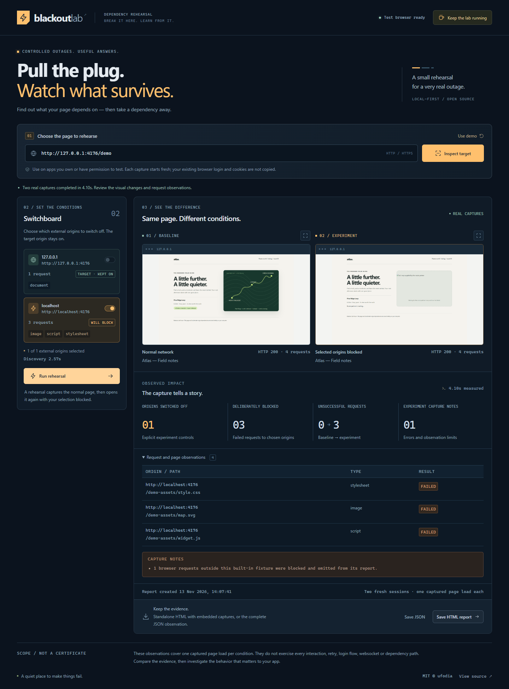

<p align="center">
  
</p>

# Blackout Lab

**Switch off a dependency. See what disappears.** Open your site in a fresh test browser, choose external origins to block, and compare real before-and-after screenshots with a request log.

[First experiment](docs/guide.md) · [Architecture](docs/architecture.md) · [Local interface](docs/reference.md) · [Privacy](docs/privacy.md) · [MIT license](LICENSE)

[](https://github.com/ufodia/blackout-lab/actions/workflows/checks.yml)

[](https://buymeacoffee.com/ufodia)



## Rehearse a small piece of the internet going away

A page can depend on a font host, image service, map provider or remote API before anyone presses a button. Blackout Lab makes those dependencies visible and lets you block selected origins inside an isolated test session. The result is a concrete comparison you can inspect and share with a teammate.

The tool runs on your computer. There is no hosted audit service, account, or cloud report upload.

| Observe                     | Choose                    | Rehearse                                       | Keep                                        |
| --------------------------- | ------------------------- | ---------------------------------------------- | ------------------------------------------- |
| Origins requested by a page | External origins to block | A fresh navigation with those requests aborted | PNG screenshots and local HTML/JSON reports |

## Start locally

Install **Node.js 24 LTS** and Git, then run:

```sh
git clone https://github.com/ufodia/blackout-lab.git
cd blackout-lab
npm ci
npx playwright install --no-shell chromium
npm run dev
```

Open the printed local address, normally `http://127.0.0.1:5173`. Choose **Use demo**, then **Inspect target**, so you can see a dependency disappear without relying on an internet service. Follow the [first-experiment guide](docs/guide.md) to select origins and compare captures.

On Windows, use `npm.cmd` and `npx.cmd` if PowerShell blocks the corresponding `.ps1` launchers.

For the built application:

```sh
npm run build
npm start
```

Keep the local server running while you use the workspace. The browser-driving backend is part of the application; opening the built HTML directly is insufficient.

## What 0.1.0 does

- Opens one HTTP(S) page at a fixed 1440 × 960 viewport in a fresh Chromium context.
- Observes requested origins during a bounded page-load window.
- Protects the target's own origin and lets you select external origins for blocking.
- Captures a baseline and a second page load with the chosen origins blocked.
- Records request outcomes and failures alongside real PNG screenshots.
- Exports local HTML and JSON reports for the captured experiment.
- Includes a local demonstration target for repeatable development and testing.

## Read the evidence at the right scale

An origin is the combination of **scheme, hostname and port**. Blocking a CDN origin affects requests to that origin in the test browser. It does not disable the provider, change your system network settings, or identify a dependency hidden behind your own server's proxy.

Each condition covers one navigation and a 1.2-second observation window after the navigation attempt. It does not click through a checkout, reuse an existing login session, import browser cookies, or exercise every route. Service workers are blocked. General-target WebSocket traffic is not controlled or reported. A complete-looking screenshot is evidence about that capture, not a resilience certification.

Reports can expose page content, titles and URL paths. Review them before sharing; see [the privacy boundary](docs/privacy.md).

## Develop and verify

```sh
npm run verify
npm run test:e2e
```

`verify` runs type checking, unit tests and a production build. Browser checks require the Chromium installation from setup. See the [verification guide](docs/testing.md) for reproducible checks and the conditions they do not cover.

| Documentation                            | Purpose                                                          |
| ---------------------------------------- | ---------------------------------------------------------------- |
| [Usage guide](docs/guide.md)             | Demo, origin selection, comparison, reports and troubleshooting  |
| [Architecture](docs/architecture.md)     | Browser isolation, request routing and the local-server boundary |
| [Interface reference](docs/reference.md) | Experiment inputs, evidence semantics and data handling          |
| [Privacy](docs/privacy.md)               | Captured data, sanitization and sensitive report contents        |
| [Testing](docs/testing.md)               | Source checks, browser checks and manual review                  |
| [Restore from GitHub](docs/restore.md)   | Rebuild on a replacement computer from `main`                    |

## Support the next useful experiment

If Blackout Lab helps you find a failure before a user does, you can [buy ufodia a coffee](https://buymeacoffee.com/ufodia). Support is voluntary and helps maintain browser compatibility, regression tests and documentation. Everyone gets the same open-source tool.

Have a reproducible issue or an improvement? Read [CONTRIBUTING.md](CONTRIBUTING.md). Use [SECURITY.md](SECURITY.md) for sensitive findings.

## License

[MIT](LICENSE) · Copyright © 2026 **ufodia**.
