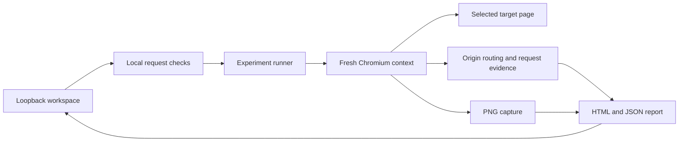

# Architecture and experiment boundary

Blackout Lab 0.1.0 combines a browser workspace with a local Node.js backend. Playwright drives a separate Chromium context for each observed pass.

## Responsibilities

- **Frontend:** target input, observed-origin selection, experiment state, screenshot comparison and report download controls.
- **Local server:** loopback binding, Host/Origin and custom-header checks, bounded JSON input, and experiment orchestration.
- **Runner:** URL validation, isolated contexts, origin-level request aborts, timed capture and evidence sanitization.
- **Reports:** local representations of the captured experiment. Screenshots are actual browser output, not reconstructed page mockups.

The TypeScript/Vite frontend cannot perform this experiment alone. Request routing belongs to the separate Playwright-controlled browser. The local backend must remain running in both development and built-application use.

| Source               | Responsibility                                                                      |
| -------------------- | ----------------------------------------------------------------------------------- |
| `server/start.mjs`   | Development/built startup and bounded `--port` argument parsing                     |
| `server/app.mjs`     | Loopback HTTP server, JSON endpoints, single-operation lock and static/Vite serving |
| `server/guards.mjs`  | Target/origin validation, request guards, body parsing and service grouping         |
| `server/capture.mjs` | Browser launch, isolated captures, routing, bounds and evidence sanitization        |
| `server/demo.mjs`    | Deterministic local target and alternate-origin assets                              |
| `src/main.ts`        | Workspace state, origin selection, comparison and downloads                         |
| `src/report.ts`      | Evidence types, unsuccessful-request predicate and static HTML report generation    |

Development embeds Vite middleware and attaches its WebSocket transport to the same Node HTTP server and port. `npm start` and `npm run preview` both serve the built application through the Node backend.

## Isolation model

Each pass uses a fresh browser context. It does not reuse the operator's everyday browser cookies, storage, extensions or login profile. Service workers are blocked. The runner observes navigation without clicking controls or importing an authenticated state.

Inspection uses one capture. Rehearsal launches a new baseline and blackout capture in separate contexts within a new browser operation; the earlier inspection screenshot is not reused. Dynamic page content can differ between them even without a dependency failure, so the evidence must be interpreted as two timed observations rather than a pixel-perfect counterfactual.

## Blocking model

The unit of selection is a URL origin: scheme, hostname and effective port. Matching external-origin HTTP(S) requests are aborted through browser routing in the blackout pass. Both the target's original origin and its baseline redirect destination are protected. A selected origin must appear in the rehearsal's fresh baseline; stale selections fail with an input error.

This boundary covers captured HTTP(S) requests. General-target WebSockets are not controlled or reported. The tool cannot separately control an upstream service that the target's backend fetches and re-serves under its own origin. It also does not exercise requests that require later routes, clicks or state changes.

For the exact built-in `/demo` fixture, the runner instead applies a narrow allowlist of the app's `127.0.0.1` and `localhost` origins at its current port. It blocks outside HTTP(S) requests and all WebSockets, omits their detailed origin/path data, and reports a generic attempted-request count. The fixture also has a restrictive content-security policy. This special boundary does not apply to unrelated targets.

## Local-server boundary

The application binds only to IPv4 loopback `127.0.0.1`. It accepts the literal Host names `127.0.0.1` and `localhost` at its current port. A supplied Origin must match that exact host origin, cross-site browser requests are rejected, and API POSTs require JSON plus `X-Blackout-Lab: 1`. The header is a fixed request marker, not a secret or per-session token. These protections are part of the interface; the application is not designed as a publicly exposed multi-user service.

Target URLs are parsed and validated as data. They do not become shell commands. Userinfo credentials are rejected. The runner does not need cloud credentials or an account to operate.

## Data model

An experiment ties together its target, viewport, selected blocked origins, observations, screenshots and request outcomes. Recorded request URLs omit queries and fragments; request headers, bodies and cookies are not stored.

Screenshots, titles and URL paths remain meaningful content. They can contain private material even when the request log has been sanitized. The backend has no report database; the workspace retains the returned experiment in memory until you replace or leave it. Downloads are the durable report files. See [privacy.md](privacy.md).

## Work budgets and failure evidence

The runner uses a fixed 1440 × 960 viewport, 10-second navigation timeout, 1.2-second observation window, 500-request budget per capture, and 45-second operation limit. Navigation failures can yield a partial snapshot with a capture note. A failed screenshot instead returns HTTP 502; the runner does not generate a placeholder PNG that could be mistaken for evidence.

## Separate public installation site

The tracked `site/` files explain installation and show the included demo's screenshot. `scripts/build-site.mjs` copies those reviewed static files and the workspace image into `site-dist/`; the Vercel configuration publishes that output. It does not bundle or expose the local Node/Playwright API, accept target URLs, or store experiment reports. See [deployment.md](deployment.md).

## Deliberate scope

The initial product tests one URL, one viewport and one bounded initial-load scenario. It does not provide authenticated audits, scripted user journeys, provider uptime monitoring, or a resilience certificate. Keeping this scope explicit makes each report's evidence easier to review and reproduce.
